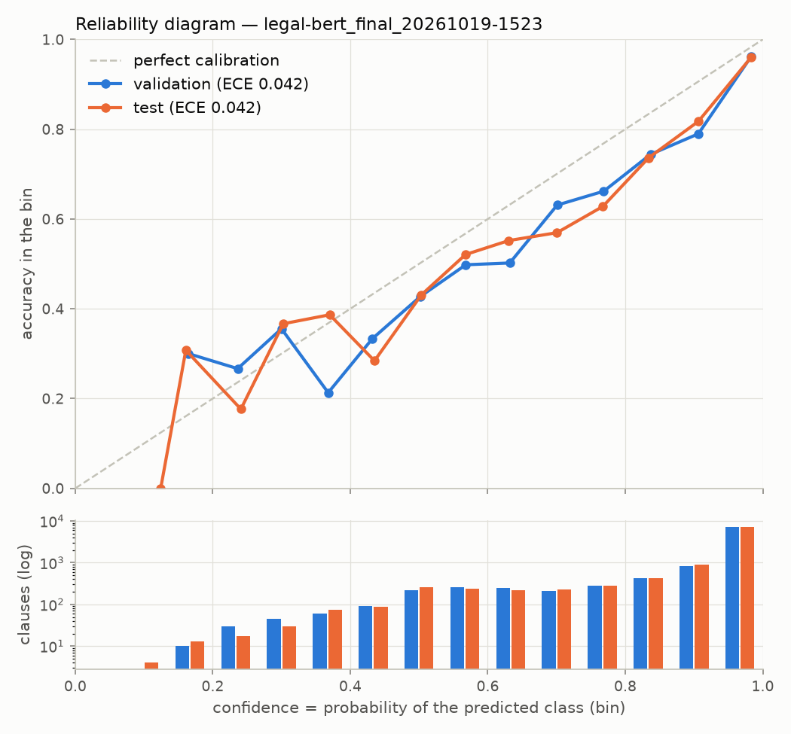
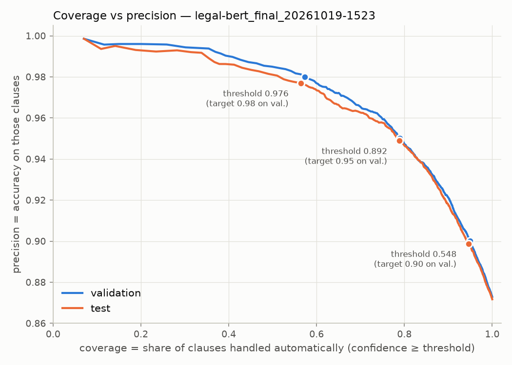
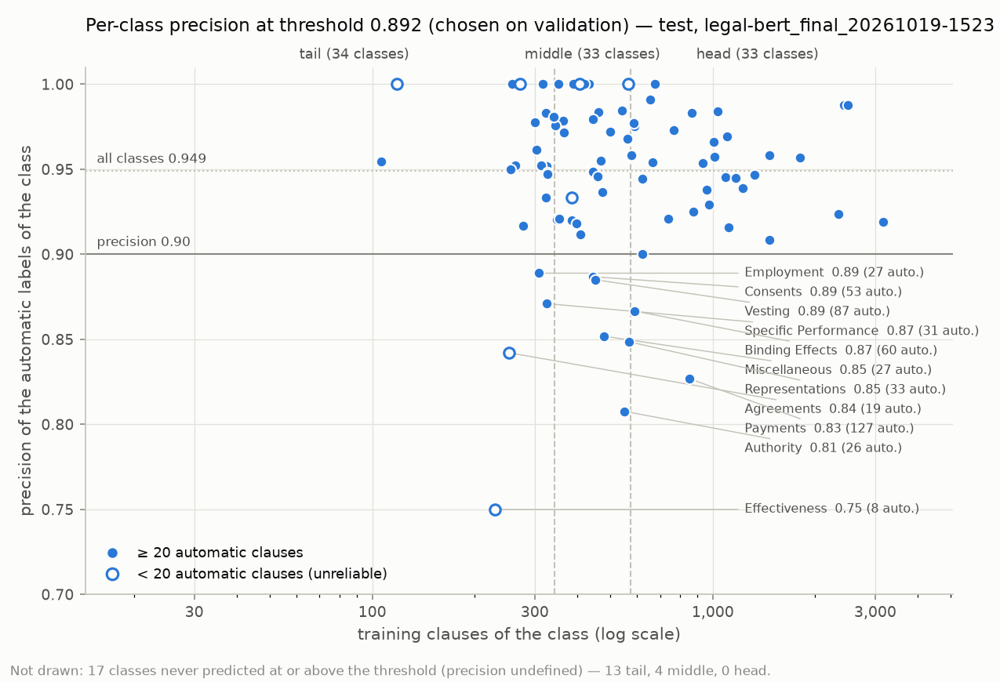

# Model card — Clause Review Assistant (NLP core)

> Quantified classification and retrieval results below come from the recorded runs and `results/` artifacts.
>
> **Audit scope:** per-slice performance (section 5) and a bounded counterfactual stress test (section 6) of the final
> model, from notebook 06 (`results/audit/`). Retrieval results come from notebook 05 on a fixed stratified 5% test
> sample. Draft lawyer queries are not evaluated because domain-expert relevance judgments are unavailable.

## 1. Description

| | |
|---|---|
| Components | (1) clause-type classifier, 100 LEDGAR classes; (2) similar-clause search engine |
| Classification model | `nlpaueb/legal-bert-base-uncased`, full fine-tuning; Hugging Face revision `15b570cbf88259610b082a167dacc190124f60f6` |
| Embedding models evaluated | `sentence-transformers/all-MiniLM-L6-v2`, `BAAI/bge-small-en-v1.5`, BM25, and MiniLM + BM25 reciprocal-rank fusion |
| Training data | LEDGAR / LexGLUE: 60,000 clauses from contracts filed with the SEC (EDGAR), 2016-2017 |
| Language | English (legal, United States) |
| Team | Robin, Amandine, Brian — Albert School, October 2026 |

## 2. Intended use

- Pre-label the type of every clause during a due diligence, **to speed up** a lawyer's review.
- Suggest comparable clauses from the firm's clause bank.
- Flag low-confidence clauses for **priority human review**.

## 3. Prohibited or discouraged uses

- **Non-English clauses** (French, German…) and clauses drafted with practices very different from US SEC
  contracts. The training data is English clauses from US SEC filings only (60,000 clauses, 2016-2017), and the
  model was never tested on another language or legal system: no performance estimate exists for them. The
  jurisdiction counterfactuals of section 6 (New York → Luxembourg / England) change one word in a US clause; they do
  not test European drafting.
- **Clause types outside the 100 LEDGAR labels.** The classifier has no "other" class: it always returns one of the
  100 labels, and it was not tested on clauses outside them. Its confidence is not a reliable alarm either: the model
  is over-confident (test mean confidence 0.913 for an accuracy of 0.872, ECE 0.0425, section 8).
- **Legal advice**, including judgments on the validity, enforceability or fairness of a clause. The model predicts
  a clause type; nothing in its labels or in our evaluation measures legal quality. Retrieval relevance is measured
  as "same LEDGAR label" (section 7), which does not show that a retrieved clause meets a specific legal constraint.
- **Fully automatic labelling of rare clause types.** On the 2019 test set, tail classes reach a macro-F1 of 0.716
  against 0.932 for head classes (section 5). At the recommended threshold, 13 tail classes are never predicted at
  or above it, so any of their clauses that passes automatically carries a wrong label, and 14.2 % of the tail
  clauses labelled automatically are wrong (115 of 811) against 2.6 % for head classes (section 8).
- **Decisions without human review** (e.g. marking a contract as "compliant"), and in particular any use of a label
  whose confidence is below **0.892** without a lawyer's check. That threshold was chosen on validation for 95 %
  precision; on the 2019 test set, the 2,112 clauses below it contain 68.6 % of the model's errors. Labels above it
  are still pre-labels: 403 wrong labels (5.1 % of the 7,888 automatic ones) would pass unreviewed (section 8).
- **Whole documents**: the system was trained and evaluated clause by clause, not on full contracts.

## 4. Overall performance

| Model / metric (2019 test set) | Value | 95 % CI |
|---|---:|---:|
| Legal-BERT full fine-tuning — macro-F1 | 0.7905 | Not estimated |
| Legal-BERT full fine-tuning — accuracy (micro-F1) | 0.8717 | Not estimated |
| TF-IDF + logistic regression — macro-F1 | 0.7625 | Not estimated |
| TF-IDF + logistic regression — accuracy | 0.8486 | Not estimated |
| Legal-BERT, de-duplicated test macro-F1 | Not computed | — |

The Legal-BERT result is from the final run `legal-bert_final_20261019-1523`; the TF-IDF result is from
`notebooks/01_eda_baseline.ipynb`. Both prediction files cover the same 10,000 test clauses in the same order.
The paired comparison finds Legal-BERT ahead of TF-IDF by 0.0281 macro-F1 (95 % paired-bootstrap CI
[0.0180, 0.0390], 1,000 resamples, seed 42; McNemar p = 1.71 × 10⁻¹⁶). This supports a statistically significant
advantage on this test split under the pre-specified analyses. Caveat: the TF-IDF baseline uses a fixed C = 1.0 and
was not tuned on validation as pre-registered (validation macro-F1 0.7666), so this gap may be slightly overstated.
For full fine-tuning vs. LoRA, Δ macro-F1 = 0.0214 (95 % paired-bootstrap CI [0.0126, 0.0365], 1,000 resamples,
seed 42). The classifier test set is the 2019 chronological split.

The audit notebook computes slice macro-F1 over the true classes represented in each slice. Training-frequency
groups are defined by terciles of per-class train counts; clause-length groups use training word-count quartiles.
Party-role groups rely on keyword heuristics, can overlap, and are not verified contract-type or party metadata.
Automatic retrieval metrics use a reproducible sample of 5% of each test-label group (at least one query per
represented label), not the full test set. The full training bank is retained. Audit results are in sections 5
and 6.

## 5. Per-slice performance

Final model `legal-bert_final_20261019-1523` on the full 2019 test set (10,000 clauses). Numbers from
[`results/audit/slice_performance.csv`](../results/audit/slice_performance.csv)
([`notebooks/06_bias_audit.ipynb`](../notebooks/06_bias_audit.ipynb)). Mean confidence = mean probability of the
predicted class. Slice macro-F1 averages only the classes present in the slice, so a slice with few clauses per class
gives a volatile value; no confidence interval was computed for the slices.

- **Class frequency**: tercile of the class's training-set count (tail 23–341, middle 345–569, head 578–3,167
  training clauses; 34 / 33 / 33 classes), the same groups as in section 8.
- **Clause length**: word count against the training-set quartiles (short ≤ first quartile, long > third quartile,
  medium in between).
- **Party roles**: a clause enters a group when both role words appear in it (e.g. "borrower" and "lender"). No test
  clause matched two pairs, so the role groups do not overlap here.

| Slice | Macro-F1 | Accuracy | Mean confidence | Support | Comment |
|---|---:|---:|---:|---:|---|
| Class frequency: head | 0.932 | 0.928 | 0.947 | 6,350 | |
| Class frequency: middle | 0.844 | 0.797 | 0.854 | 2,367 | |
| Class frequency: tail | 0.716 | 0.731 | 0.854 | 1,283 | Weakest group; confidence well above accuracy |
| Clause length: short | 0.735 | 0.869 | 0.913 | 2,960 | Lower macro-F1, same accuracy |
| Clause length: medium | 0.791 | 0.871 | 0.916 | 4,797 | |
| Clause length: long | 0.786 | 0.878 | 0.906 | 2,243 | |
| Party roles: Borrower / Lender | 0.759 | 0.883 | 0.926 | 394 | Keyword proxy |
| Party roles: Employer / Employee | 0.583 | 0.702 | 0.861 | 47 | Keyword proxy; **small sample, indicative only** |
| Party roles: Landlord / Tenant | 0.601 | 0.695 | 0.862 | 118 | Keyword proxy |
| Party roles: Buyer / Seller | 0.851 | 0.900 | 0.918 | 60 | Keyword proxy; **small sample, indicative only** |
| Party roles: none detected | 0.790 | 0.874 | 0.913 | 9,381 | Reference for the role groups |

The largest gap is between frequent and rare clause types: tail classes reach a macro-F1 of 0.716 against 0.932 for
head classes (accuracy 0.731 vs 0.928), and the model is as confident on tail clauses as on middle ones (mean
confidence 0.854 for both, for accuracies of 0.731 and 0.797).
Employer/employee (0.583) and landlord/tenant (0.601) clauses score below clauses with no detected role (0.790), but
on small samples of 47 and 118 clauses, so these gaps are indications, not established differences. Party roles are
keyword proxies, not verified contract-type or party metadata.

## 6. Robustness and bias

Counterfactuals are generated from a reproducible random sample of 1,000 test clauses (seed 42). A pair is created
only when the clause contains the targeted text feature, and each pair changes that one feature. The pronoun edit
swaps only the words "he" and "she". These are heuristic stress tests, not legal redrafts, and should be manually
inspected; their results are limited to this sample and these transformations. Synthetic European/French OOD probes
and retrieval-stability tests are not part of the focused final audit.

Final model `legal-bert_final_20261019-1523`. Numbers from
[`results/audit/counterfactual_summary.csv`](../results/audit/counterfactual_summary.csv)
([`notebooks/06_bias_audit.ipynb`](../notebooks/06_bias_audit.ipynb)). Flip = the predicted label changes;
confidence change = mean over the pairs of (confidence after the edit − confidence before), confidence being the
probability of the predicted class.

| Perturbation | Pairs | Flips | Flip rate | Mean confidence change |
|---|---:|---:|---:|---:|
| Swap borrower ↔ lender | 42 | 1 | 0.024 | +0.0010 |
| Swap employer ↔ employee | 6 | 0 | 0.000 | −0.0039 |
| Swap landlord ↔ tenant | 11 | 0 | 0.000 | −0.0012 |
| Swap buyer ↔ seller | 7 | 0 | 0.000 | −0.0003 |
| Pronouns he ↔ she | 17 | 0 | 0.000 | +0.0003 |
| Jurisdiction New York → Delaware | 44 | 0 | 0.000 | −0.0011 |
| Jurisdiction New York → England | 44 | 0 | 0.000 | −0.0051 |
| Jurisdiction New York → Luxembourg | 44 | 0 | 0.000 | −0.0060 |
| Currency USD → EUR ($ → €) | 21 | 0 | 0.000 | +0.0001 |
| **All perturbations** | **236** | **1** | | |

**The samples are small.** Only clauses that contain a targeted feature yield a pair, so the planned sample of
1,000 test clauses yielded only 236 pairs in total, 6 to 44 per perturbation; the three jurisdiction edits are
applied to the same 44 clauses. "No flip observed" on 6 to 44 pairs is therefore **weak evidence of robustness,
not proof**: it remains compatible with a real flip rate of several percent or more. No significance test or
confidence interval was computed.

Within this sample, one prediction changed in 236 pairs (a borrower ↔ lender swap, on a clause whose original
confidence was already below the 0.892 review threshold of section 8; see
[`results/audit/counterfactual_predictions.csv`](../results/audit/counterfactual_predictions.csv)). Every mean
confidence change stays below 0.01 in absolute value; the largest drops follow the two non-US jurisdictions
(−0.0060 for Luxembourg, −0.0051 for England).

## 7. Retrieval evaluation

Automatic relevance is defined as matching the query clause's LEDGAR label. Metrics are computed on the fixed,
stratified 5% sample of the test set and must not be presented as full-test estimates. Manual-query results are
not reported: the drafted questions lack domain-expert relevance judgments. Therefore, the automatic benchmark
does not establish that retrieved clauses satisfy detailed legal constraints such as notice periods or governing
jurisdiction.

| Method | P@5 | MRR@10 | nDCG@10 |
|---|---:|---:|---:|
| MiniLM | 0.7639 | 0.8512 | 0.7421 |
| BGE-small | **0.7876** | **0.8752** | **0.7723** |
| BM25 | 0.7800 | 0.8683 | 0.7553 |
| MiniLM + BM25 (RRF, c=60) | 0.7844 | 0.8685 | 0.7665 |

The benchmark contains 499 sampled test clauses. Same-label relevance measures retrieval of clauses with the same
broad LEDGAR class; it does not establish that a result satisfies specific legal constraints or answers a lawyer's
question. No expert-judged lawyer-query metrics are available.

## 8. Calibration and human review threshold

Final classification model `legal-bert_final_20261019-1523` (Legal-BERT, full fine-tuning). Numbers from
[`results/calibration_legal-bert_final_20261019-1523.json`](../results/calibration_legal-bert_final_20261019-1523.json)
(`scripts/calibration_report.py`). Confidence = probability of the predicted class (top-label calibration); ECE over
15 equal-width bins.

| Split | Accuracy | Mean confidence | ECE |
|---|---:|---:|---:|
| Validation (2018) | 0.8729 | 0.9142 | 0.0422 |
| Test (2019) | 0.8717 | 0.9131 | 0.0425 |

A clause is labelled automatically when its confidence is ≥ the threshold; otherwise it is sent to a lawyer. Each
threshold is chosen on the validation set (smallest threshold reaching the target precision there), then applied
unchanged to the test set. Precision = accuracy on the clauses labelled automatically (95 % Wilson interval).

| Target precision (validation) | Threshold | Test coverage | Test precision [95 % CI] | Test clauses sent to review | Test errors sent to review |
|---|---:|---:|---:|---:|---:|
| 0.90 | 0.548 | 94.7 % | 0.8988 [0.8926; 0.9047] | 534 | 25.3 % |
| **0.95 (recommended)** | **0.892** | **78.9 %** | **0.9489 [0.9438; 0.9536]** | **2,112** | **68.6 %** |
| 0.98 | 0.976 | 56.4 % | 0.9770 [0.9727; 0.9806] | 4,359 | 89.9 % |

**Interpretation.** The model is **over-confident**: on the 2019 test set it is on average 0.913 sure of its label but
right 0.872 of the time (ECE 0.0425; validation 0.0422), and accuracy is below confidence in every bin above 0.4 —
even in the top bin, which holds 72 % of the clauses, it says 0.983 and is right 0.960 of the time. With the
recommended threshold of 0.892 (chosen on validation for 95 % precision), a law firm reviewing 10,000 clauses would
let the model label 7,888 of them (78.9 %) on its own, 94.9 % of them correctly [95 % CI 94.4 %; 95.4 %], and send
2,112 to a lawyer; those 2,112 contain 68.6 % of the model's errors, while 403 wrong labels (5.1 % of the automatic
ones) would go through unreviewed.

**Per class at the recommended threshold.** Numbers from
[`results/calibration_per_class_legal-bert_final_20261019-1523.csv`](../results/calibration_per_class_legal-bert_final_20261019-1523.csv)
(`scripts/calibration_per_class.py`, test set, threshold 0.892 unchanged). Precision of a class = share of the clauses
labelled automatically *as* that class that truly belong to it; it is unreliable below 20 such clauses. Frequency
group = tercile of the class's training-set count: tail 23–341, middle 345–569, head 578–3,167 clauses.

| Group | Classes | Share of its test clauses labelled automatically | Precision of the automatic labels | Classes never labelled automatically | Classes below 0.90 (≥ 20 automatic labels) |
|---|---:|---:|---:|---:|---:|
| Tail | 34 | 63.2 % | 0.948 | 13 | 4 (2) |
| Middle | 33 | 61.9 % | 0.946 | 4 | 5 (5) |
| Head | 33 | 88.4 % | 0.950 | 0 | 2 (2) |

- **11 classes fall below 0.90 precision**: Effectiveness (0.750), Authority (0.808), Payments (0.827), Agreements
  (0.842), Representations (0.848), Miscellaneous (0.852), Binding Effects (0.867), Specific Performance (0.871),
  Vesting (0.885), Consents (0.887) and Employment (0.889). Effectiveness and Agreements rest on fewer than 20
  automatic labels (8 and 19) and are unreliable. Only Payments has its whole 95 % interval below 0.90
  ([0.752; 0.883], 127 automatic labels); the other ten intervals contain 0.90.
- **They are not mostly tail classes** (4 tail, 5 middle, 2 head), and the precision is the same in the three
  groups. Rare classes pay instead in **coverage and hidden errors**: 17 classes (13 tail, 4 middle) are never
  predicted at or above the threshold, yet 74 of their 586 test clauses still pass automatically under a wrong label;
  and 14.2 % of the tail clauses labelled automatically are wrong (115 of 811), vs 2.6 % for head classes (148 of
  5,611).
- **Recommendation**: the global threshold delivers ≈ 0.95 on average, not for every class. A lawyer should
  spot-check the automatic labels of the classes above, and of contracts rich in rare clause types. Per-class
  thresholds, if wanted, must be chosen on the validation set.

**Limitations.** No temperature scaling (only the probability of the predicted class is stored, not the full
probability matrix). Top-label calibration says nothing about the 99 other probabilities or the top-5 suggestions.
One global threshold for the 100 classes: the per-class precision rests on 0 to 545 automatic labels per class and was
measured on the test set only after the threshold was fixed. The test
precisions sit 0.0011 to 0.0030 below their target (each target inside the 95 % interval), as expected from a
threshold chosen to just reach its target on validation.

## 9. Known limitations

- **Small counterfactual samples**: 236 pairs from 1,000 sampled test clauses, 6 to 44 per perturbation, with the
  three jurisdiction edits on the same 44 clauses (section 6). "No flip observed" is weak evidence, not proof of
  robustness.
- Counterfactual replacements are lexical stress tests and may alter legal meaning or produce awkward wording;
  generated examples must be reviewed before interpreting changes.
- **Keyword-based party proxies**: LEDGAR has no contract-type or party metadata, so the per-party breakdown relies
  on role words found in the clause. Only 619 of the 10,000 test clauses fall in a role group (47 to 394 per group),
  and the rules can miss uncommon role terms or ambiguous drafting (section 5).
- **Retrieval evaluated on a sample**: 499 test queries (a stratified 5 % of each test label), with relevance defined
  as "same LEDGAR label"; these are not full-test estimates and not lawyer-judged relevance (section 7).
- **No temperature scaling**: the prediction files store only the probability of the predicted class, so the
  over-confidence measured in section 8 (test ECE 0.0425) is not corrected.
- **LSTM not delivered**: the BiLSTM baseline was excluded from this delivery (README scope note), so the planned
  Legal-BERT vs LSTM comparison is not reported; the classification comparison covers TF-IDF, full Legal-BERT
  fine-tuning and LoRA.
- No out-of-distribution evaluation: the synthetic probes in `eval/ood/` are unlabelled and were not used by the
  final audit, so nothing is measured on European or French contracts.
- The shared LEDGAR loader does not expose row-level contract years. The test split is 2019 only, so no
  within-test year comparison is reported.
- Chronological split: future performance may drop as drafting practices evolve.

## 10. Reproducibility

Seed 42; configuration and versions of every run in `results/runs/<run_id>/config.json`.
